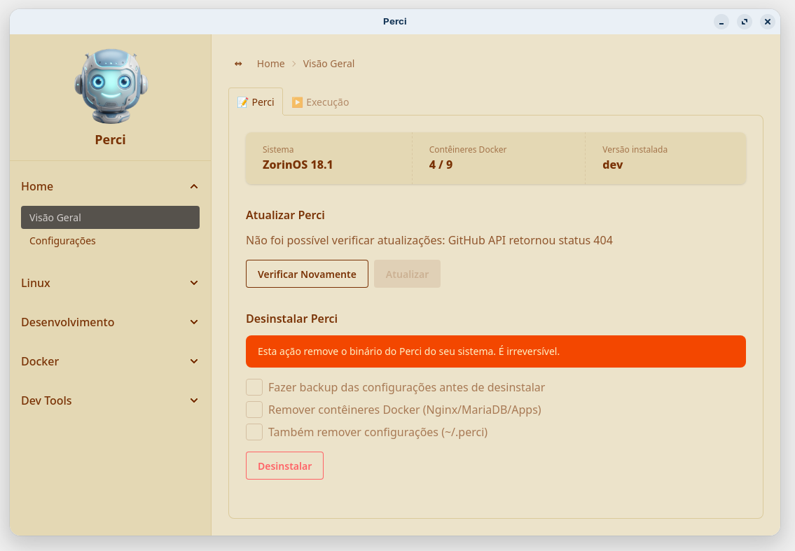

# perci.gnl

> [!IMPORTANT]
> **Perci was discontinued** and replaced by **Perci82 System** and **Perci82 Dev** ([oito2/perci82](https://github.com/oito2/perci82)). Version 1.10.0 is the last release, and this repository is kept for reference only — see [Moving to Perci82](#moving-to-perci82).

A Linux desktop app that turns a fresh install into a fully configured development workstation in minutes — post-installation, SDKs, IDEs, and a per-project Docker stack behind one window.

[](https://github.com/oito2/perci/releases)
[](https://go.dev)
[](https://kernel.org)
[](LICENSE)
[](https://github.com/oito2/perci/actions/workflows/ci.yml)
[](https://github.com/oito2/perci/actions/workflows/release.yml)
[](#ai-usage-in-this-project)

🌐 **Language:** English · [Português](docs/pt-br/leiame.md)

---

## Table of Contents

- [Moving to Perci82](#moving-to-perci82)
- [Overview](#overview)
- [Prerequisites & Quick Installation](#prerequisites--quick-installation)
- [Update & Maintenance](#update--maintenance)
- [Documentation](#documentation)
- [AI Usage in This Project](#ai-usage-in-this-project)
- [License](#license)

---

## Moving to Perci82

Perci was split into two apps, released from [oito2/perci82](https://github.com/oito2/perci82):

| App | Covers | Install |
|---|---|---|
| **Perci82 System** | Linux administration: post-installation, OS and app updates, fonts, file templates, Flatpaks | `install-system.sh` |
| **Perci82 Dev** | Development: environment (prerequisites, SDKs, AI apps, terminals, IDEs), Docker, repositories, AI contexts, skills and MCPs | `install-dev.sh` |

```bash
# Perci82 System
curl --proto '=https' --proto-redir '=https' --tlsv1.2 --connect-timeout 10 --max-time 600 -fsSL https://raw.githubusercontent.com/oito2/perci82/main/install-system.sh | bash

# Perci82 Dev
curl --proto '=https' --proto-redir '=https' --tlsv1.2 --connect-timeout 10 --max-time 600 -fsSL https://raw.githubusercontent.com/oito2/perci82/main/install-dev.sh | bash
```

- **Same settings:** both apps use the same `~/.perci` folder and read the `config.yaml` Perci wrote, and they import the backups Perci exports.
- **Removing Perci:** each installer finds the old Perci (`/usr/local/bin/prci`) and offers to remove its binary, `perci` alias, menu entry, icons and autostart entry, keeping `~/.perci`. To remove it yourself, use **Home → Visão Geral → Desinstalar Perci** without **Também remover configurações** — see [Uninstallation](docs/en/getting-started/uninstallation.md).
- **This repository:** `install.sh` no longer installs Perci (it prints the commands above), and the old releases stay available.

---

## Overview

> This is a pretty personal project. It's the result of a bunch of `.sh` scripts I already had, gathered into a single Go app.

> The goal is simple: land on a fresh machine and have everything I need configured in minutes. That's why it only covers the distros I actually use day to day: Linux Mint 22.3 (Cinnamon and XFCE), Ubuntu 24.04 and 26.04 (GNOME and Budgie), Fedora 44 (GNOME, KDE Plasma and Budgie), ZorinOS 18.1 (Core and Lite), and Pop!_OS 24.04 (COSMIC).

> Feel free to use and adapt it however you like — just know it solves pretty specific problems of mine, it's not meant to be a generic setup tool.



A desktop GUI (Go + [Wails](https://wails.io)), six sidebar categories, no daemon, no database — just `~/.perci/config.yaml`:

- **Home** — an overview of your system, the discontinuation notice, uninstall Perci itself, settings (theme, sidebar mascot, workspace, Flatpak scope, system tray).
- **Linux** — distro/DE-aware post-installation, system updates, fonts, file templates, Flatpak apps.
- **Desenvolvimento** — build prerequisites, Go/Rust/Flutter SDKs, AI apps, terminals, IDEs (Zed, VS Code, VSCodium, Android Studio, Antigravity).
- **Docker** — a per-project Docker application stack (Nginx/MariaDB/PHP/Node/PHP+Node containers, with Moodle routing), create and manage containers.
- **Repositórios** — GitHub/GitLab accounts, each with its folder, commit identity and SSH key (also used by `git` in the terminal); fetch, fast-forward and clone the account's repositories; generate their LICENSE, code of conduct, support page and issue/pull request templates; export/import accounts and repositories to another machine.
- **Dev Tools** — Moodle plugin development folders mounted into Moodle containers, AI context generation for Claude Code, Gemini, Codex, OpenCode and Antigravity (`AGENTS.md`, `.instructions/*.md` and each agent's own files) with a list of the folders that have one, updated or exported from there, AI agent skills, MCP server registration.

An optional system tray icon gives quick access to containers and system updates from a compact window.

---

## Prerequisites & Quick Installation

| OS | Status | Distributions | Runtime dependencies |
|---|---|---|---|
| Linux (`amd64`) | Supported | Debian/Ubuntu-based and Fedora — full experience on Linux Mint 22.3, Ubuntu 24.04/26.04 (incl. Ubuntu Budgie), Fedora 44 (incl. Budgie), Zorin OS 18.1, Pop!_OS 24.04 | GTK4, WebKitGTK 6.0 |
| Windows | Not supported | — | — |
| macOS | Not supported | — | — |

Privilege escalation (`pkexec`/PolicyKit), package management (`apt`/`dnf`), distro detection, and the GTK4 GUI stack are all Linux-specific — see [Installation → Supported Platforms](docs/en/getting-started/installation.md#supported-platforms).

**1. Runtime libraries** (usually already present on a desktop install):

```bash
# Debian/Ubuntu-based
sudo apt install -y libgtk-4-1 libwebkitgtk-6.0-4

# Fedora
sudo dnf install -y gtk4 webkitgtk6.0
```

**2. Build and install from source** (requires Go 1.26+):

```bash
# Build dependencies — Debian/Ubuntu-based
sudo apt install -y libgtk-4-dev libwebkitgtk-6.0-dev
# Build dependencies — Fedora
sudo dnf install -y gtk4-devel webkitgtk6.0-devel

git clone https://github.com/oito2/perci.git
cd perci
make install    # builds ./prci, installs it to /usr/local/bin with the `perci` alias and a menu entry
```

**3. Run it** — from the application menu, or:

```bash
prci
```

Manual binary install, release artifacts, and supported architectures: **[Installation](docs/en/getting-started/installation.md)**.

---

## Update & Maintenance

- **Installed from a release:** 1.10.0 is the last release, and it no longer updates itself — Home → Visão Geral shows the discontinuation notice instead. Earlier versions still reach 1.10.0 through **Home → Visão Geral → Atualizar Perci**.
- **Installed from source:** pull and reinstall:
  ```bash
  git pull && make install
  ```

To remove Perci, see **[Uninstallation](docs/en/getting-started/uninstallation.md)**.

---

## Documentation

Full bilingual documentation site: **[docs/en/index.md](docs/en/index.md)** · **[docs/pt-br/index.md](docs/pt-br/index.md)**

- [Why perci.gnl](docs/en/concepts/why-perci.md) · [How it works](docs/en/concepts/how-perci-works.md) · [Architecture](docs/en/concepts/architecture.md)
- [Configuration reference](docs/en/reference/configuration.md)
- [Troubleshooting](docs/en/troubleshooting/common-issues.md)
- Contributing: [CONTRIBUTING.md](CONTRIBUTING.md) · [Code of Conduct](CODE_OF_CONDUCT.md)

---

## AI Usage in This Project

This project was developed with the assistance of generative AI tools:

- **Scope:** Implementation of features, unit tests, refactoring and documentation, under the author's direction.
- **Oversight:** All generated code was manually reviewed, tested and validated before integration.

---

## License

GPL-3.0 — see [LICENSE](LICENSE).
